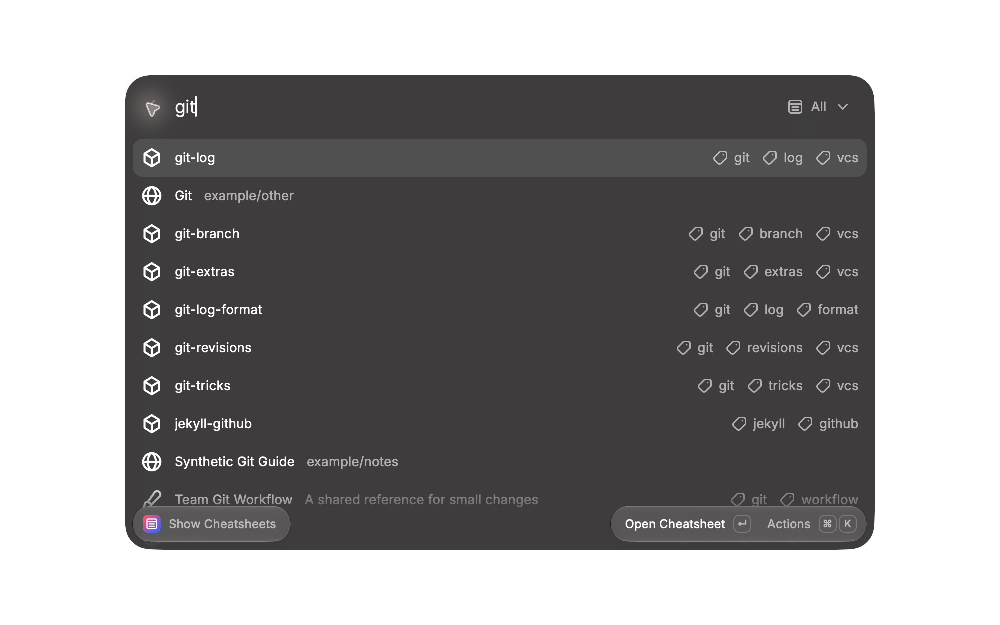

# Cheatsheets Remastered

Developer references, your own Markdown and GitHub cheatsheets in Raycast. Search your sheets, keep favorites and pick up where you left off.

[Install from the Raycast Store](https://www.raycast.com/smcnab1/cheatsheets-remastered) · macOS

Open **Show Cheatsheets** to browse the bundled [DevHints](https://devhints.io/) references. No account or setup is needed.

## Commands

| Command                   | What it does                                                     |
| ------------------------- | ---------------------------------------------------------------- |
| Show Cheatsheets          | Search bundled, personal and synced GitHub sheets.               |
| Create Custom Cheatsheet  | Write Markdown sheets with descriptions, tags and saved drafts.  |
| Manage Custom Cheatsheets | Edit, delete or import personal sheets from Markdown files.      |
| Repo Manager              | Add GitHub repositories and sync their Markdown for offline use. |

Inside a sheet, use **Search Within Sheet** (`⌘F`) to find text or headings. **Copy Section Markdown** copies a section; **Copy Original Markdown** copies the complete source.

To import an existing `.md` file, open **Manage Custom Cheatsheets** and choose **Import Markdown File** from Actions. This creates a personal copy without changing the original file.

## Add a GitHub repository

1. Open **Repo Manager**, sign in with GitHub and choose **Add Repository**.
2. Enter the owner and repository name separately. Set the actual default branch; the form suggests `main`. Add a subdirectory or select **Private Repository** if needed.
3. Choose **Sync Repository**, then open the saved sheets in **Show Cheatsheets**.

Sync uses OAuth with `repo read:org read:user` scopes. The `repo` permission includes write access, though the extension only reads repositories. The optional **GitHub Token** preference does not override OAuth.

## Help and development

Bundled, personal and previously synced sheets work offline. Remote links, images and repository updates may need a connection. Your library stays in local storage without cross-device sync. Failed downloads keep the previous snapshot.

See [sync, import and recovery help](docs/migration.md) for limits and troubleshooting. Back up local data before downgrading. Keep tokens and private content out of [bug reports and feature requests](https://github.com/smcnab1/cheatsheets-remastered/issues).

For development, see the [release checklist](RELEASE_CHECKLIST.md), [changelog](CHANGELOG.md) and [roadmap](ROADMAP.md).

[MIT licensed](LICENSE). Bundled DevHints references are by Rico Sta. Cruz and contributors; see [attribution and content licenses](ATTRIBUTION.md).
